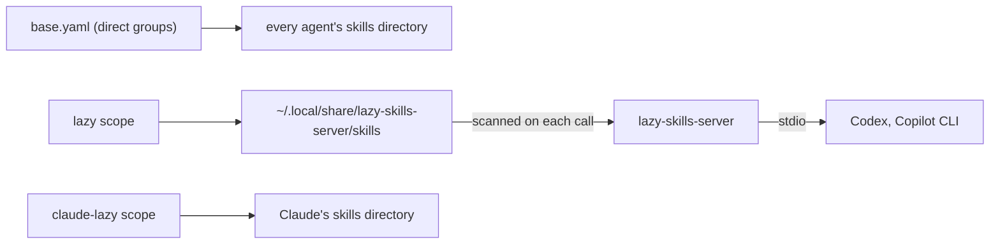

# lazy-skills-server

An MCP server that serves the "lazy" tier of skills to Codex and Copilot CLI as two tools, instead of loading
them natively into every session. Specialized skills, such as embedded Linux, Nix, and Python, add their
descriptions to every session, though few sessions use them. Behind this server they cost two tool
definitions, and the agent loads a skill only when a request needs it. Claude Code gets the same domains as
ordinary native skills, because it already defers skill loading itself.

```bash
lazy-skills-server                          # serve the default lazy skills directory over stdio
lazy-skills-server --skills-dir /some/dir   # serve a different directory instead
lazy-skills-server --print-skills-dir       # print the resolved directory and exit
```

## How It Works

The tier is a directory: every lazy skill lives under `skills/shared/lazy/`, in a subdomain named after its
direct counterpart. `skills/kasetto/base.yaml` lists only direct groups, which every agent loads natively. Two
Kasetto scopes list the lazy groups, and each deploys them to a different place:

- [`skills/kasetto/lazy/`](../../../skills/kasetto/lazy/kasetto.yaml) deploys them to the server's skills
  directory, which Codex and Copilot reach only through this server.
- [`skills/kasetto/claude-lazy/`](../../../skills/kasetto/claude-lazy/kasetto.yaml) deploys the same domains
  into Claude's own skills directory.

Those two files are the authoritative list of lazy groups. `just check-lazy-domains` fails when the two scopes
disagree, when a lazy scope declares a group outside `lazy/`, or when `base.yaml` declares one inside it.



The server scans its directory one level deep, as `<skills-dir>/<skill>/SKILL.md`, which is how Kasetto deploys
a skill. It rescans on every tool call, so a Kasetto sync during a session shows up at the next call with no
restart. Only the skill names listed in `find_skills`'s tool description are fixed at startup, because Codex
ignores `list_changed` notifications. A new skill is therefore findable at once but named in that description
only from the next session.

The server is registered directly with each agent rather than behind mcpproxy. Behind the proxy, the agent would
first have to think of searching the proxy's `retrieve_tools` for skills, and agents do not reliably take that
discovery step. Direct registration costs a few hundred tokens per session and keeps the catalog in plain view.

## Tools

Both tools are read-only, take no filesystem path, and resolve names only against the scanned catalog.

- `find_skills(query)` returns the name and description of the skills whose name or description contains any
  of the whitespace-separated query terms, ignoring case and hyphens, best first and at most ten. Each term is
  weighted by how rare it is across the catalog (BM25's inverse document frequency), so a word in nearly every
  description barely counts, and a term in the skill's name counts double. An empty or missing query returns
  every skill. The rule was all-terms until 2026-10-04, when a query spanning two skills was seen to return
  neither.
- `load_skill(name)` returns the skill's full `SKILL.md` text, its absolute directory, and the relative paths of
  its other files. The agent then reads `references/` and runs `scripts/` from that directory with its own
  tools. An unknown name is a tool error that lists up to three close names. A large skill can exceed a
  client's inline tool-result limit: Copilot CLI 1.0.91 saved a 29.8 KB `nix-flakes` result to a temporary file
  and read it in ranges, which works but costs the agent extra calls
  ([record](../../../agents/docs/copilot/evaluations/2026-10-04-copilot-test-session.md)).

A skill is left out of the catalog, with the reason logged, when its frontmatter is missing or unparsable or
its `name` differs from its directory name. A file whose resolved path leaves its skill's directory, such as an
outward symlink, is left out of the file list.

## Skills Directory

One function resolves the directory, in this order: the `--skills-dir` argument, then the
`LAZY_SKILLS_SERVER_SKILLS_DIR` environment variable, then `$XDG_DATA_HOME/lazy-skills-server/skills`, then
`~/.local/share/lazy-skills-server/skills`. Empty variables are skipped. Because the default needs no argument,
neither agent's committed configuration carries a machine-specific path.

The `lazy` scope's `destination` must equal `lazy-skills-server --print-skills-dir`.
`scripts/kasetto-deploy.sh` checks this before every sync of that scope and refuses to deploy on a mismatch. If
you override the directory on a machine, change the scope's `destination` to match.

When the resolved directory is missing, unreadable, or holds no valid skill, the server exits non-zero with a
message naming the path it tried. The agent then reports a failed MCP server rather than an empty catalog. All
diagnostics go to stderr, since stdout carries the MCP protocol.

## Installation and Registration

`just deploy-config` installs the server with `uv tool install --reinstall src/tools/lazy-skills-server`
(declared in `deploy/shared.conf.yaml`). That puts a non-editable copy on `PATH`, so an unsaved edit or a branch
switch in this checkout never changes a running server.

The registration is declared once, as `[servers.lazy-skills-server]` in `mcp/servers.toml`, and rendered into
`agents/codex/config.toml` and `agents/copilot/mcp-config.json` by `just mcp::render`. Never edit
those generated entries by hand; [the manifest README](../mcp-manifest/README.md) covers the workflow.

## Maintenance

Run the tests, or the tests plus lint and type checks:

```bash
just test-lazy-skills-server
just check-tree lazy-skills-server
```

To install a code change, run `just deploy-config`, which reinstalls the tool from the working tree. To
reinstall the server alone, run `uv tool install --reinstall src/tools/lazy-skills-server` from the repository
root. A running agent session
keeps the old process, so start a new session to use the new code.

To move a skill into the lazy tier, or back out of it:

1. `git mv` it between `skills/shared/<domain>/` and `skills/shared/lazy/<domain>/`.
2. When the move creates or empties a group, add or delete that group's entry in both lazy scopes, or in
   `skills/kasetto/base.yaml`, in the same commit.
3. Run `just check-lazy-domains`, then commit. The post-commit hook redeploys every affected scope.

The "Lazy Skills" section of `agents/codex/AGENTS.md.j2` and `agents/copilot/copilot-instructions.md.j2` names
example subjects in prose, and nothing checks it. Update it, then run `just deploy-config`, when a whole kind of
skill changes tier.

### An agent never calls `find_skills`

Work down this list, since each step depends on the one before it:

1. Confirm that the server starts. `lazy-skills-server --print-skills-dir` must name a directory that holds
   skills, and the agent must not list the server as failed. If the directory is empty, run
   `just deploy-skills --scope lazy`.
2. Confirm the registration with `just check-agent-config`. It compares the live `~/.codex/config.toml` and
   `~/.copilot/mcp-config.json` with their sources.
3. Confirm that the instruction line reached the agent: `~/.codex/AGENTS.md` and
   `~/.copilot/copilot-instructions.md` must contain the "Lazy Skills" section. If not, run
   `just deploy-config`.
4. Check the wording. The instruction line, the server's `instructions`, and both tool descriptions in
   `src/lazy_skills_server/server.py` are all the agent sees. If the request's domain is missing from the
   instruction line, the agent has no reason to search.

The design record, including the alternatives weighed, is
[`lazy-skill-loading.md`](../../../docs/plans/archived/lazy-skill-loading.md).
