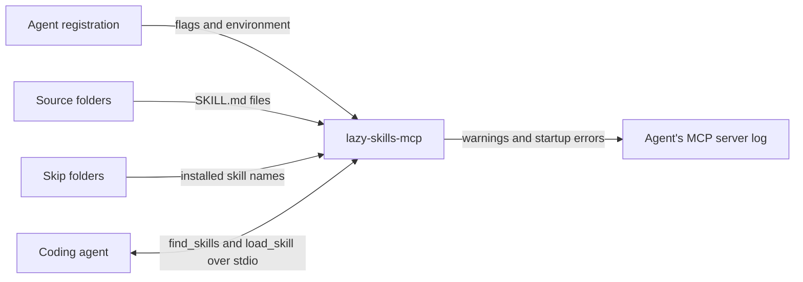
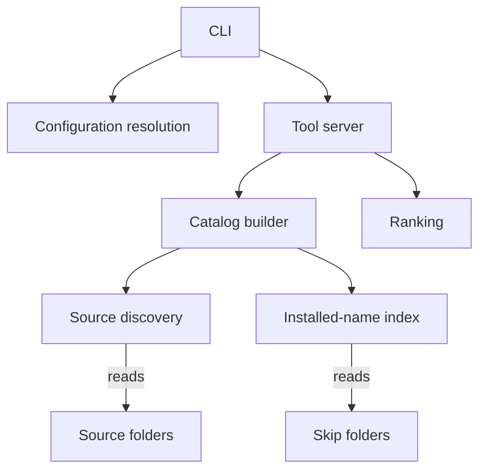

# Skill Sources Design

Status: accepted by the user, 2026-11-01, after a pressure test. Once implemented, the code
wins and this design is updated to match.\
Design basis: the brainstorm draft [skill-sources-draft.md](skill-sources-draft.md), whose decisions table and
review constraints are accepted input. No spec governs the work: the draft fixes the user-visible behaviour, and this
design realizes it. The baseline is release 0.1.1. Format: arc42, since the repository has no design convention.\
Open items: none; see the [questions register](#questions-register).

## 1. Introduction and Goals

### 1.1 Requirements Overview

Release 0.1.1 serves one flat directory of skills. A deployment must copy its on-demand skills into that directory
and keep a second list naming them. This change lets the server read the skills a user already has, from one or
more folders in any layout a skill tool produces, and serve only the skills the agent does not load natively. The
release is 0.2.0, a minor release: every 0.1.1 invocation keeps its meaning, apart from two behaviour changes listed in
section 11.

The accepted behaviour, from the draft's decisions table:

| Topic | Behaviour |
| --- | --- |
| Sources | `--skills-dir` may repeat; `LAZY_SKILLS_MCP_SKILLS_DIR` may hold a `PATH`-style list. With neither, today's default folder is the one source. |
| Layout | A folder holding `SKILL.md` is a skill and is not searched further; any other folder is a group and is searched. Hidden folders are skipped. Search stops 8 levels below a source. |
| Skipping | The repeatable `--skip-installed-in` option names folders the agent loads natively. Their skills are left out. There is no default. Skip folders are read flat. A skill counts as installed when its folder name or frontmatter `name` matches. A missing skip folder is treated as empty and logs a warning. |
| Conflicts | The first skill found under a name wins, and a warning names both paths. |
| Symlinks | Symlinked skill and group folders are followed; each real folder is visited once. A skill still lists no file outside its own folder. |
| Description | `find_skills`'s description lists every served name up to 300, then counts the rest. |
| Printing | `--print-skills-dir` prints the sources, one per line, in order. |

### 1.2 Quality Goals

1. Predictability: The same folders always produce the same catalog and the same warnings, independent of
   filesystem listing order. A user can tell from the configuration alone which skill wins a name.
2. Compatibility: An 0.1.1 registration, with one flat source and no skip folder, serves the same skills after
   the upgrade. The two deliberate exceptions are listed in section 11.
3. Fail visibly: A configuration mistake shows up as a failed server or a logged warning, never as a silently
   different catalog.
4. Per-call cost stays small: The server rescans on every tool call, so pointing it at a whole skills checkout
   must not make each call slow.

### 1.3 Stakeholders

A user registering the server with an agent needs predictable options and diagnostics in the agent's MCP log. The
agent-setup repository pins a release and scripts against the interface contract in the README; it adopts the new
options at its next pin bump. An agent consuming the tools sees only tool names, descriptions and results, which this
change keeps stable apart from the description's name list.

## 2. Architecture Constraints

| Constraint | Source | Consequence |
| --- | --- | --- |
| stdout carries the MCP protocol | MCP stdio transport | All diagnostics go to stderr through `logging`. |
| Codex ignores `list_changed` notifications | README | The description's name list is fixed at startup; the catalog itself is rescanned per call. |
| The README's interface contract is public | README, pinned deployments | New options extend it; no 0.1.1 meaning changes except those in section 11. |
| Tool-agnostic layout rules | Draft, user decision | Discovery reads only folders and `SKILL.md` files, never a tool's lock or config file. |
| Python 3.12 and later, `mcp>=2.2,<3` | `pyproject.toml` | Uses only the standard library and current dependencies. |

## 3. Context and Scope

| Participant | Exchange |
| --- | --- |
| Agent registration | Supplies `--skills-dir`, the skip option, and the environment when the agent starts the server. |
| Source folders | Hold the skills to serve, flat or grouped, written by any tool. Read only. |
| Skip folders | The folders the agent itself loads skills from. Read only, one level deep. |
| Coding agent | Calls the two tools; receives names, descriptions, `SKILL.md` text and file paths. |
| Agent's MCP log | Receives stderr. A non-zero exit before the protocol starts shows as a failed server. |

The server never writes to any folder, installs skills, or reads a skill tool's own files.

## 4. Solution Strategy

The change separates three questions that 0.1.1 answers in one place:

1. Which folders? Configuration resolution turns flags and environment into an ordered list of sources and a
   list of skip folders. It touches no files.
2. Which skills exist? Discovery walks each source by the layout rule and produces candidate skills in a fixed
   order. A separate step reads the skip folders into a set of installed names.
3. Which skills are served? Selection removes name duplicates, keeping the first, then removes installed names.
   The result is the catalog both tools use.

Keeping discovery and selection apart makes the order rule (quality goal 1) explicit and testable on plain data. The
per-call cost (goal 4) is met by reading only `SKILL.md` frontmatter during a scan. A skill's file list is built only
when `load_skill` asks for that skill.

## 5. Building Block View

### 5.1 Overall Structure

| Component | Responsibility and interface |
| --- | --- |
| CLI | Parses flags, sets up logging, prints sources for `--print-skills-dir`, builds the server, and turns a startup failure into exit 1 with a message. |
| Configuration resolution | Pure function from flag values and environment to a `SkillSources` value: the ordered source paths and the skip paths. No filesystem access. Replaces `resolve_skills_dir`. |
| Source discovery | Walks one source by the layout rule and yields candidate skills (name, description, folder) in walk order. Logs invalid skills, depth-limit hits and unreadable folders. |
| Installed-name index | Reads each skip folder one level deep and returns the set of installed names. Logs missing or unreadable skip folders. |
| Catalog builder | Runs discovery over every source in order, keeps the first candidate per name, removes installed names, and fails closed when a source is unusable or nothing remains. Called on every tool call, as `load_catalog` is today. |
| Tool server | Builds `find_skills` and `load_skill` over the catalog builder. Owns the startup name list and its cap. Builds a skill's file list on `load_skill`. |
| Ranking | Unchanged: ranks catalog entries against a query. |

Source discovery and the installed-name index share one frontmatter reader, `read_frontmatter` in `skill.py`,
and one set of error-tolerant folder checks in `folders.py`. A
catalog entry no longer carries its file list; `load_skill` lists files for the one skill it returns.

### 5.2 Source Discovery Internals

Discovery is a depth-first walk from the source folder, which is depth 0.

- Visiting a folder: If it holds a `SKILL.md` file, it is a skill: discovery validates it and does not descend.
  This applies at depth 0 too, so a source that is itself a skill serves that one skill.
- A valid skill has parsable frontmatter with string `name` and `description`, and `name` equals the folder's
  name. Discovery yields it.
- An invalid skill is logged with its reason and yields nothing. Discovery still does not descend into it.
- A group is any other folder. Discovery visits its child folders in sorted name order, skipping names that
  start with `.`. A group yields no log line, whether or not it holds skills.
- Depth: A folder at depth 8 is visited, so a skill there is found. A group at depth 8 is not descended; discovery
  logs one warning naming it.
- Symlinks: A symlinked folder is visited like any other. Discovery records each real path it visits, across all
  sources in one scan, with the shallowest depth at which it was reached. A skill folder already recorded is passed
  over without a log line. A group already reached at the same or a shallower depth is passed over too; a group
  reached again by a shorter path is searched again, so the depth limit never hides a skill that a shorter path
  reaches. Nothing is lost, and a cycle ends.
- Unreadable folders: A group or skill folder that cannot be listed or read is logged and passed over. A filesystem
  error while checking whether a folder holds `SKILL.md` counts as "no", so the listing that follows reports it.

The source folder itself follows the fail-closed rule in section 8.3.

## 6. Runtime View

### 6.1 Startup With Two Sources and a Skip Folder

The registration runs `lazy-skills-mcp --skills-dir ~/skills/personal --skills-dir ~/src/agent-skills
--skip-installed-in ~/.codex/skills`.

1. The CLI passes the flag values and environment to configuration resolution, which returns sources
   `[~/skills/personal, ~/src/agent-skills]` and skip folders `[~/.codex/skills]`. The flags replace the environment
   variable entirely.
2. The tool server asks the catalog builder for a catalog.
3. The catalog builder runs source discovery on `~/skills/personal`, then on `~/src/agent-skills`, collecting
   candidates in walk order. `python-style` appears in both; the builder keeps the personal one and logs a warning
   naming both folders.
4. The installed-name index reads `~/.codex/skills` and returns the names of the skills Codex loads natively. The
   builder removes those names.
5. The tool server sorts the remaining names, embeds up to 300 of them in `find_skills`'s description, and starts the
   protocol.

### 6.2 A Tool Call After a Skill Changes

During the session, a skill tool adds `nix-flakes` to `~/src/agent-skills`. The next `find_skills` call runs the
catalog builder again, so the new skill can match. It is absent from the description until the next start. When
`load_skill` returns a skill, the tool server lists that skill's files at that moment, under the rule that no file
outside the skill's real folder is listed.

### 6.3 Failure: Nothing Left to Serve

If every candidate is installed natively, the catalog builder raises the startup error "all N skills found are
installed in a skip folder", naming the skip folders. The CLI prints it and exits 1, so the agent shows a failed
server rather than an empty tool. If a source is missing, the error names that source, as in 0.1.1.

## 7. Deployment View

One local process, started by the agent over stdio, runs every component. It needs read access to the sources and
skip folders and no network. It keeps no state between calls or runs, so there is nothing to migrate. Rolling back
means reinstalling 0.1.1; a registration that uses the new options must then drop them, because 0.1.1 rejects unknown
flags.

## 8. Crosscutting Concepts

### 8.1 Configuration Precedence

Sources come from the first of these that yields at least one path:

1. Every non-empty `--skills-dir` value, in command-line order.
2. `LAZY_SKILLS_MCP_SKILLS_DIR`, split on `os.pathsep`, keeping non-empty entries in order.
3. `$XDG_DATA_HOME/lazy-skills-mcp/skills`, when `XDG_DATA_HOME` is set and non-empty.
4. `~/.local/share/lazy-skills-mcp/skills`.

A layer never merges with a lower one, matching 0.1.1, where `--skills-dir` overrode the variable. Skip folders come
only from the repeatable option `--skip-installed-in DIR`, in command-line order; empty values are
ignored. The server expands a leading `~` in every source and skip path, from flags and from the variable alike,
because agents start MCP servers without a shell: Codex, for one, passes arguments through literally. It expands
nothing else, such as `$HOME`.

`--print-skills-dir` prints the resolved sources, one per line, and exits 0 without touching the filesystem. With one
source the output is byte-for-byte that of 0.1.1.

### 8.2 Skill Identity and Ordering

A skill's identity is its name, which discovery guarantees equals its folder name. Candidates are ordered by source
order, then by walk order within a source. The first candidate under a name is kept. Each later one is dropped with a
warning naming the kept folder and the dropped folder. Installed names are removed after duplicates, so a warning
reports a conflict between sources even when the name is also installed.

A skip folder's child counts as installed under its folder name, and also under its frontmatter `name` when that
parses. Any parse failure in a skip folder is ignored silently: the folder name alone still counts.

### 8.3 Failure Handling

| Condition | Result |
| --- | --- |
| A source is missing, not a folder, or unreadable | Startup fails, naming the source. During a session, the tool call returns an error naming it. |
| A source yields no valid skill | Allowed when another source yields skills; logged as a warning. |
| No valid skill in any source | Startup fails: "no valid skill found in" with the sources. |
| Every valid skill is installed | Startup fails: "all N skills found are installed in a skip folder", naming them. |
| A skip folder is missing or unreadable | Treated as empty; one warning names it. |
| An invalid skill, a depth-limit hit, an unreadable group | Logged; the scan continues. |

Warnings repeat on every rescan, as 0.1.1's do. Deduplicating them across calls would need state; the agent's MCP log
is the only reader, and a repeated warning about a persisting problem is accurate.

### 8.4 Description Name List

The startup catalog's names are sorted and joined. Up to 300 are listed in full. Beyond that, the first 300 are
listed and the description adds "and N more; call find_skills to search them". `find_skills` with an empty query still
returns the whole catalog, as today.

## 9. Architecture Decisions

### 9.1 File lists move from the scan to `load_skill`

0.1.1 walks every file of every skill on each call. Over a skills
checkout that is the dominant cost and serves no purpose for `find_skills`. Listing one skill's files on `load_skill`
keeps the result identical and makes the scan read one small file per skill.

### 9.2 A source that is itself a skill serves that skill

The layout rule applies uniformly from depth 0, so a user can
point the server at one skill folder. The alternative, rejecting such a source, adds a special case with no benefit.

### 9.3 No built-in exclusion list beyond hidden folders

Excluding names such as `node_modules` or `tests` would make
discovery guess at layouts and could hide a real skill named `tests`. A source should be the skills root, which the
README says. Revisit if real checkouts prove noisy.

### 9.4 Same real folder reached twice is not a conflict

Two paths to one real folder are one skill, so passing over the
second without a warning loses nothing. A warning is reserved for different folders sharing a name.

### 9.5 The server expands a leading `~`

0.1.1 relied on a shell to expand it, but agents launch MCP servers directly,
so a registration naming `~/src/agent-skills` would point at a folder literally named `~`. Expanding only a leading
`~` covers the common case without a variable-expansion language.

### 9.6 The skip option has no environment variable

Skipping is per agent and lives in each registration's arguments.
A shared variable would apply one agent's native folders to every agent started from that environment.
[BACKLOG.md](../../BACKLOG.md) keeps the variable as a later option.

The draft's decisions table records the user's choices and the alternatives rejected there.

## 10. Quality Requirements

- Success signal (draft): Given a fixture source tree and a fixture skip folder, `find_skills` with an empty query
  returns exactly the source's valid skills minus those whose names are installed in the skip folder.
- Predictability: The same fixture tree, created in two different directory-entry orders, yields the same catalog
  order and the same kept skill for a duplicate name.
- Compatibility: The 0.1.1 test suite's fixtures, a single flat source, produce the same catalog, apart from the
  behaviour changes in section 11.
- Per-call cost: A `find_skills` call over a checkout of `jonatsu/agent-skills`
  reads one `SKILL.md` per skill and no other skill file. No timing target is accepted.

## 11. Risks and Technical Debt

1. Two 0.1.1 behaviours change: A symlinked skill folder whose real location lies outside the source is now served
   instead of skipped. A folder without `SKILL.md` is now a group and searched, instead of skipped with a warning. Both
   go in the changelog. A user who relied on the first as a filter loses it.
2. Name-only matching hides a different skill with an installed name: That follows the user's "when in doubt, stay
   out" decision; the README states it.
3. Agents may change their native folders: The skip option takes whatever folders a registration names, so a
   change needs only a configuration update, not a release.
4. A skills root holding unrelated `SKILL.md` files, such as test fixtures, serves them. The README tells users to
   point at the skills root; a later exclusion option can address real cases.
5. The README's interface contract fixes the observable rules, so later work must stay additive: an exclusion list
   must be opt-in, the depth limit may rise but not fall, and configuration layers must not start merging.
6. Skill names are not checked against the Agent Skills naming rule, only against their folder name, so any folder
   name reaches `find_skills`'s always-loaded description. The trust boundary does not move: whoever can name the
   folder can already write the `SKILL.md` that `load_skill` returns. Enforcing the rule later would drop skills
   that 0.2.0 serves, so it would be a breaking change.

## 12. Glossary

| Term | Meaning |
| --- | --- |
| Source | A folder the server reads skills from, flat or grouped. |
| Skip folder | A folder the agent loads skills from natively; its skills are left out of the catalog. |
| Skill folder | A folder holding `SKILL.md`. The server does not search inside it for further skills. |
| Group | Any other folder under a source, searched for skills. |
| Candidate | A valid skill found by discovery, before duplicate and installed names are removed. |
| Catalog | The skills served after selection; both tools use it. |

## Questions Register

No question remains open. The per-call cost goal in section 10 stands without a timing target, by the user's
decision.

## Planning Handoff

The obligations that need the most scrutiny are the deterministic order rule (section 8.2), the fail-closed table
(section 8.3), and the file-confinement rule moving into `load_skill` unchanged. Each needs tests at the component
level and through the in-memory MCP client. The README's interface contract, the CLI help, and the changelog change
with the code, and the release is 0.2.0.
