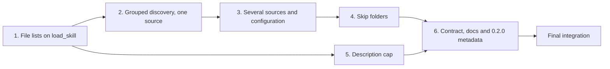

# Skill Sources Implementation Plan

Status: executed, 2026-11-01; units 1 to 6 landed, final integration open until the reviews close and the tag
is authorized.\
Basis: the accepted [skill sources design](skill-sources-design.md) at commit `4f9d7aa`, realizing the decisions in
[the draft](skill-sources-draft.md). Section references below are to the design.\
Execution record: [the section at the end of this plan](#execution-record).

## Implementation Overview

The work turns the 0.1.1 single-directory scan into the design's pipeline: configuration resolution, source
discovery, an installed-name index, and a catalog builder (section 5). It starts with the one refactor that changes no
behaviour, moving file lists from the scan to `load_skill`, because every later unit builds on the slimmer catalog
entry. Grouped discovery then replaces the flat scan for a single source, so the layout, symlink and depth rules land
and are tested before several sources multiply them. Multi-source configuration and the order rule follow, then skip
folders, which consume the catalog builder. The description cap is independent and small. Documentation and the
release metadata come last, when the interface is final.

Every unit keeps `just test` and `just check` green, so each commit is a safe stopping point.

## Shared Preflight

### P1: Environment

Work in `~/src/projects/lazy-skills-mcp` with mise active, which pins Python 3.12.14 and supplies 3.13 and 3.14 for the
version matrix. `just test` runs pytest from `uv.lock`; `just check` runs every pre-commit hook (hygiene, betterleaks,
secretlint, ruff, strict mypy); `just test-all-pythons` runs the suite on 3.12, 3.13 and 3.14. Record a baseline of all
three before the first edit. Tests build skill trees under pytest's `tmp_path` (see `tests/conftest.py`) and never touch
a real skills directory.

### P2: Guidance

Before editing Python, load the `python-style`, `python-testing` and `coding-standards` skills; load
`python-error-handling` for units that change failure paths (units 2 to 4). Before changing a function's signature or
removing one, run LSP `findReferences` on it and confirm the list with `rg`. Use test-driven development for every
behavioural rule: write the failing test from the design's wording first. Keep module docstrings truthful: several
still mention Kasetto and "the lazy tier", and a unit that rewrites a module updates its docstring to describe the
skill sources model.

### P3: Review

The implementer self-reviews each unit's diff against the design sections it cites and records the check results in
the execution record. An independent `code-reviewer` subagent, dispatched with `model: opus` because symlink following
widens what the server reads, reviews units 2 to 4 together once unit 4 lands, before unit 6 starts. Units 1 and 5 are
small and behaviour-preserving or isolated, so self-review and their tests close them. Findings are fixed by the
implementer and rechecked by the same reviewer; a blocking finding keeps unit 6 waiting.

## Unit 1: File Lists Built on `load_skill`

### Outcome and Rationale

A scan reads only each skill's `SKILL.md`; `load_skill` lists the files of the one skill it returns, with unchanged
results (sections 4 and 9.1). This makes the per-call cost goal reachable before discovery starts walking whole
checkouts.

### Changes

Remove `files` from `SkillEntry` in `src/lazy_skills_mcp/catalog.py` and stop calling `_list_other_files` during
`load_catalog`. Expose the file-listing function, keeping its confinement rule: a file whose real path leaves the
skill's real folder is not listed. In `src/lazy_skills_mcp/server.py`, `load_skill` lists the files of the entry it
found. Move the file-list tests in `tests/test_catalog.py` to target the listing function, and keep the
`tests/test_server.py` assertions on `load_skill`'s `files`.

### Dependencies and Constraints

None. `SkillEntry` is used by `ranking.py` and the tests; confirm every use with P2's reference check.

### Verification and Completion

`just test` passes with the same `load_skill` results as before. A new test proves the scan reads no non-manifest file:
a skill containing an unreadable extra file still appears in `find_skills`. `just check` passes.

## Unit 2: Grouped Discovery for One Source

### Outcome and Rationale

One source is walked by the layout rule: skills are found at any depth up to 8, groups are searched, hidden folders are
skipped, symlinked folders are followed once, and a source that is itself a skill serves that skill (section 5.2,
section 11 item 1).

### Changes

Add the source discovery component, a depth-first walk yielding candidates in sorted order, to the catalog module or a
new `discovery.py` beside it, whichever keeps modules cohesive. It validates a skill exactly as `_load_skill_entry`
does today, logs invalid skills and does not descend into them, logs nothing for groups, logs one warning for a group
at depth 8, and keeps a set of visited real paths for the scan. Remove `_is_confined`, whose check contradicts the
symlink rule. `load_catalog` uses discovery for its single directory and keeps its fail-closed errors.

Rewrite the tests that encoded 0.1.1 behaviour now changed by the design: the symlinked skill folder pointing outside
the source is served, and a folder without `SKILL.md` is a silent group.

### Dependencies and Constraints

Unit 1. Load `python-error-handling` (P2). The file confinement rule from unit 1 stays untouched.

### Verification and Completion

New tests cover: a two-level grouped tree as in `jonatsu/agent-skills` (`development/python/<skill>`); a skill at depth
8 found and a group at depth 8 not descended, with its warning; hidden folders skipped; an invalid `SKILL.md` folder
not descended even when a valid skill sits inside it; a symlink cycle ending without a log line; the same real skill
reached through two paths appearing once; a source that is itself a skill; and identical catalogs for a tree created in
two different entry orders. `just test` and `just check` pass.

## Unit 3: Several Sources and Configuration Resolution

### Outcome and Rationale

The server reads several sources in a predictable order, resolved from flags, the variable or the default, and keeps the
first skill under each name (sections 8.1, 8.2 and 8.3).

### Changes

Replace `resolve_skills_dir` in `src/lazy_skills_mcp/location.py` with a pure function returning a `SkillSources`
value: the ordered sources and the skip folders, with a leading `~` expanded. `--skills-dir` and `--skip-installed-in`
become repeatable in `src/lazy_skills_mcp/cli.py`; `--print-skills-dir` prints one source per line. The catalog builder
runs discovery over every source in order, drops later duplicates with a warning naming both folders, and fails closed
on any missing, non-folder or unreadable source. `build_server` takes the source paths (and, from unit 4, the skip
paths) rather than a `SkillSources` value, as recorded in the execution record. This unit parses
`--skip-installed-in` but leaves skipping to unit 4.

### Dependencies and Constraints

Unit 2. Load `python-error-handling` (P2). The precedence must stay byte-compatible for 0.1.1 inputs: a single
`--skills-dir`, a single-path variable, or neither.

### Verification and Completion

`tests/test_location.py` covers: repeated flags in order; the variable split on `os.pathsep` with empty entries
dropped; flags replacing the variable entirely; the XDG and home defaults unchanged; `~` expanded in flags, the
variable and skip folders. `tests/test_cli.py` covers the multi-line `--print-skills-dir` output and its unchanged
single-source output. Catalog tests cover the duplicate rule across sources and within one source, with the warning
naming both folders, and startup failure naming a missing second source. `just test` and `just check` pass.

## Unit 4: Skip Folders

### Outcome and Rationale

Skills the agent loads natively are left out, using the folders a registration names (sections 8.2 and 8.3, and the
draft's success signal).

### Changes

Add the installed-name index: it reads each skip folder one level deep, following symlinks, and collects each child's
folder name and, where it parses, its frontmatter `name`. A missing or unreadable skip folder logs one warning and
counts as empty. The catalog builder removes installed names after the duplicate rule, and raises "all N skills found
are installed in a skip folder" when nothing remains.

### Dependencies and Constraints

Unit 3. Load `python-error-handling` (P2). After this unit, dispatch the P3 independent review of units 2 to 4.

### Verification and Completion

An end-to-end test through the in-memory MCP client proves the success signal: with a fixture source tree and a fixture
skip folder, `find_skills` with an empty query returns exactly the source's skills minus the installed ones. Other tests
cover matching by folder name and by frontmatter name, a missing skip folder's warning, the all-skipped startup failure,
and a duplicate warning still reported for an installed name. `just test`, `just check` and `just test-all-pythons`
pass. The P3 review closes with no open blocking finding.

## Unit 5: Capped Name List in the Description

### Outcome and Rationale

`find_skills`'s description lists at most 300 names, then says how many more exist (section 8.4).

### Changes

In `src/lazy_skills_mcp/server.py`, `_find_skills_description` lists the first 300 sorted names and appends "and N more;
call find_skills to search them" when the catalog is larger.

### Dependencies and Constraints

Unit 1 only; it may land before units 2 to 4.

### Verification and Completion

Tests cover a catalog of exactly 300 names, listed in full, and of 301, listing 300 and "and 1 more". `just test`
passes.

## Unit 6: Interface Contract, Documentation and 0.2.0 Metadata

### Outcome and Rationale

Users and pinned deployments can rely on the new interface: the README contract, the CLI help, the changelog and the
package version describe 0.2.0 (section 1.3, planning handoff).

### Changes

Update `README.md`: sources and grouped layouts, `--skip-installed-in` with `~/.agents/skills` named as the usual value,
the precedence and `~` expansion, the failure behaviour, the per-agent registration examples, and the interface
contract, which gains the repeatable flags, the variable's list form, the multi-line printing, nested groups, and the
skip option. Rewrite the CLI help in `cli.py` and the server docstrings to drop "lazy tier" and Kasetto wording. Add
the two behaviour changes and the new options under `## Unreleased` in `CHANGELOG.md`, then rename that section to
`## 0.2.0` and set `version = "0.2.0"` in `pyproject.toml` with `uv lock`.

### Dependencies and Constraints

Units 4 and 5, and the P3 review closed. Load `writing-readmes` for the README and `writing-for-humans` for its
reader-ready pass.

### Verification and Completion

Every example command in the README is run against a fixture tree and its output matches the README. `just check`
passes. Tagging `v0.2.0` publishes a GitHub release, which is an outward action: it waits for the user's
authorization after final integration.

## Final Integration

Run `just check`, `just test` and `just test-all-pythons`, and confirm CI passes on the pushed commit. Run the server
from the working tree against a real checkout of `jonatsu/agent-skills` with `--skip-installed-in ~/.codex/skills`, and
confirm through the in-memory client that `find_skills` returns the repository's skills minus those Codex loads
natively, and that a scan reads no non-manifest file.

Two reviews close the gate, each a fresh subagent. A `code-reviewer` with `model: opus` reviews the whole change from the
base `4f9d7aa` to the head. A separate reviewer runs `conformance-review` against the draft, the design and this plan,
over the same revisions. Both reviews' material findings go into the execution record, and both must close before the
release is proposed to the user.

## Execution Record

| Unit | Result | Commit | Notes |
| --- | --- | --- | --- |
| Baseline | `just test` 58 passed; `just check` clean; `just test-all-pythons` 58 passed on 3.12, 3.13, 3.14 | `8c9d46e` | |
| 1 | Done: 59 passed, `just check` clean; self-reviewed | `6144a5d` | New test fails the scan if it lists skill files |
| 2 | Done: 70 passed, hooks clean; self-reviewed | `9e0db29` | Scan test now patches `Path.rglob`, which any file listing must call; the earlier patch target was never called by the scan |
| 3 | Done: 84 passed, hooks clean; self-reviewed | `e65271d` | `build_server` and `load_catalog` take path sequences rather than a `SkillSources` value, which kept test churn small |
| 4 | Done: 91 passed on 3.12, 3.13 and 3.14. P3 review closed: four findings (unreadable folders crash the scan on 3.12 and 3.13; a depth-limited group hides a shorter path; a misleading warning for nested sources; two untested guarantees) fixed in `558585d` with the design amended in `e76d0ed`; the recheck found a silent drop of unsearchable folders, fixed in `5abe1f3` | `0a17bb3`, `7682a90` | `7682a90` formats `installed.py`, which `just check` skipped while it was untracked |
| 5 | Done: 93 passed, hooks clean; self-reviewed | `a20b539` | |
| 6 | Done: README, help text, docstrings, CHANGELOG and version 0.2.0; README commands run against fixture trees and their output matched (`--print-skills-dir`, the not-found and all-skipped errors) | `5fbec13`, `e46e766`, `ce83763` | |
| Final | In progress: CI passed on `e46e766`; real `jonatsu/agent-skills` checkout (97 skills) with `--skip-installed-in ~/.codex/skills` (33 names) served exactly the 65 expected, no warnings. Final code review approved with one required fix; conformance review found two defects, a test gap and doc items; all fixed in `22bc4a7` and `ce83763`. Open: clean-code and architecture reviews (proposed to the user), the `v0.2.0` tag (needs authorization) | | |
