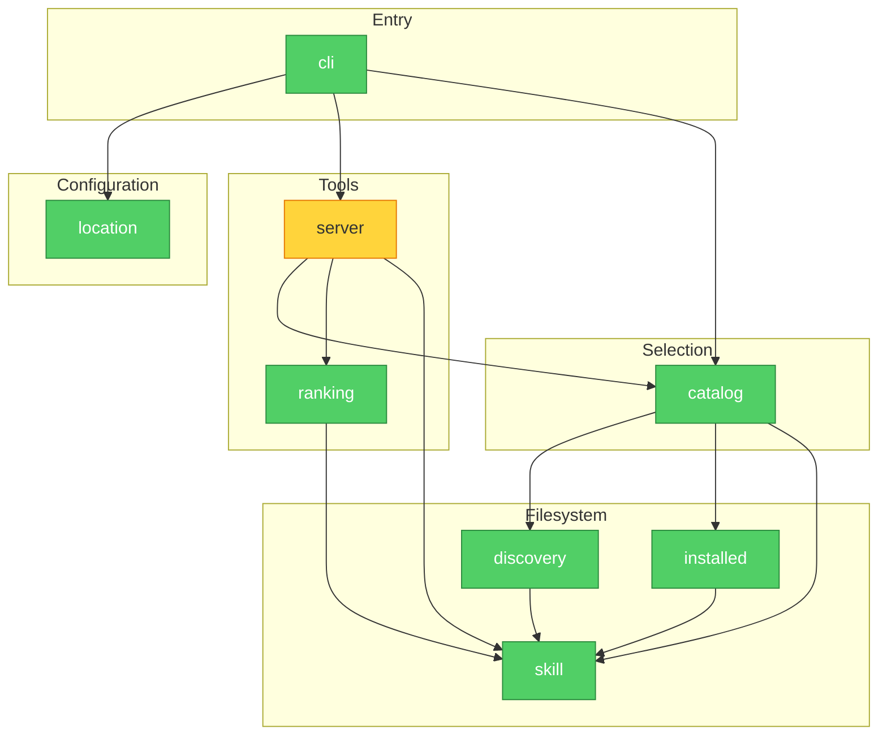

# Architecture Review: Skill Sources (0.2.0)

Mode: Architecture Audit, post-hoc, gating the `v0.2.0` tag.\
Scope: the accepted design [skill-sources-design.md](../plans/skill-sources-design.md) as amended in `e76d0ed`, and
`src/lazy_skills_mcp/` at commit `9a9e6c1` (docs: record the review outcomes and final integration so far).\
Reviewer: architecture-reviewer subagent, read-only over code; this file is the only one written.\
Health score: 92/100 (balanced preset: one Warning, three Suggestions; Informational items carry no deduction).

## Verdict

SOUND. The module graph is acyclic and layered, nothing an MCP client sends can reach a filesystem path, and the
fail-closed rules match the design. No finding blocks the tag. Two cheap items, the interface contract gap (F1) and
the unguarded reads in `load_skill` (F2), are worth landing before it.

## Module Dependency Graph

Edges point from the depending module to its dependency. The graph was built from the internal imports
(`rg "^from lazy_skills_mcp" src`). An LSP `findReferences` on `load_catalog` returned nothing because the index was
incomplete, so the text search is the evidence.

The `server` node is yellow for F2. The README contract (F1) is a document, not a module, so it has no node.

## Findings

Severities map to the brooks-audit tiers as follows: Important is a Warning, Suggested is a Suggestion, and
Informational is context with no deduction.

### F1. The interface contract omits guarantees users and the pinned deployment rely on (Important, not blocking)

Symptom: The contract list (`README.md:218-230`) names the command, the flags, the variable, the default source, the
layout rule, the skip rule and the tool names. It leaves out four behaviours that the README describes elsewhere and
that a registration depends on. The first is the source priority rule, where the first skill found under a name wins
(`README.md:193-195`, `catalog.py:71-92`). The second is exit status 1 with a stderr message on a fail-closed start
(`cli.py:81-85`). The third is the `~` expansion (`location.py:72-78`), and the fourth is the result field names
`skills[].name`, `skills[].description`, `content`, `directory` and `files` (`server.py:52-70`). The contract also
pins the literal depth `8`.

Source: Brooks-Lint R2, Change Propagation (Hyrum's Law: every observable behaviour gets depended on).

Consequence: A later change to the priority order, the exit code or a result field is not flagged as breaking, yet it
breaks a registration that lists a personal folder first to override a shared one. Under the current wording, any
of the following would force a breaking release: raising the depth limit, adding a built-in exclusion list (the
design's 9.3 "revisit" path), merging configuration layers, or adding skip folders to `--print-skills-dir`'s output.

Remedy: Add the four behaviours to the contract list before tagging. The change is additive, so it is not breaking.
Record in design section 11 that any future exclusion or filter must be opt-in and that skip folders would get their
own print flag.

### F2. `load_skill` reads files outside the scan's error handling (Suggested, not blocking)

Symptom: `server.py:162` reads `SKILL.md` with no handler, and `list_skill_files` calls `path.is_file()` with no
handler (`skill.py:155`). On Python 3.12 and 3.13, `Path.is_file` re-raises any error outside ENOENT, ENOTDIR, EBADF
and ELOOP (stdlib `pathlib.py:45` and `886-901` in 3.12.14, `pathlib/_abc.py:476-485` in 3.13.16). The `rglob`
selector still yields the children of a subfolder that can be listed but not searched (`pathlib.py:200-220`), so
their `stat` fails with EACCES. A `SKILL.md` that is deleted or made unreadable between the scan and the read fails
the same way.

Source: Brooks-Lint R3, Knowledge Duplication. The read-and-tolerate rule lives in `read_skill` and `is_folder`, but
`load_skill` re-implements the read without it.

Consequence: The client gets a generic internal error that names no path, instead of a `ToolError` naming the skill.
That cuts against design goal 3 ("fail visibly") and the direction of `22bc4a7`, which converted catalog errors to
named tool errors. Python 3.14's `is_file` swallows these errors, so behaviour differs across supported versions.

Remedy: In `load_skill`, catch `OSError` and `UnicodeDecodeError` around the read and the listing, and raise
`ToolError` naming the skill folder. In `list_skill_files`, use a tolerant `is_file` check that mirrors `is_folder`.
Add a test with a non-searchable subfolder on 3.12.

### F3. Per-call rescan cost is unbounded and gives no signal when it grows (Suggested, not blocking)

Symptom: Every `find_skills` call runs a full scan, and so does every `load_skill` call, which rescans the whole
catalog to resolve one name (`server.py:115-120`, `154`). For each folder, a scan calls `resolve()`, a `SKILL.md`
check, and a listing with one `lstat` per child. For each skill it reads the file and runs `yaml.safe_load`
(`skill.py:99-105`), and `installed_names` re-reads and re-parses every skip folder's `SKILL.md` (`installed.py:45-49`).
Nothing logs the scan's duration or size.

Source: Brooks-Lint R4, Accidental Complexity in the failure-visibility sense: the cost model is implicit.

Consequence: Cost grows linearly with folders and skills. A source pointed at a project root with a non-hidden
`node_modules` or `target` tree is walked to depth 8 on every call, which design 9.3 accepts and the README warns
about. Slowness then shows up as agent latency with no log line explaining it. The real 97-skill checkout was
measured fine (plan execution record). Concurrency is safe: mcp 2.3.0 runs sync tools through
`anyio.to_thread.run_sync` (`mcp/server/mcpserver/utilities/func_metadata.py:164`), and each scan builds fresh
state. Parallel calls multiply the cost but do not race.

Remedy: Keep the no-cache design for 0.2.0. Add one log line when a scan exceeds a threshold, giving its folder
count, skill count and elapsed time. If a large collection appears, add a frontmatter cache keyed on
`(real path, mtime_ns, size)`. That cache keeps the "changes visible at the next call" guarantee and removes most of
the YAML cost.

### F4. Discovery's visited map is shared mutable state with an unwritten contract (Suggested, not blocking)

Symptom: `catalog._first_skill_per_name` creates `visited: dict[Path, int]` and passes it into every
`discover_skills` call (`catalog.py:73-78`). Discovery mutates it (`discovery.py:50-53`), and the catalog reads its
key format (`source.resolve() in visited`, `catalog.py:76`) to decide whether to warn that a source holds no valid
skill.

Source: Brooks-Lint R2, Change Propagation (control coupling through a shared data structure).

Consequence: Changing how discovery keys or ages entries silently changes the catalog's warning logic. The coupling
is small today because the code base has about 820 lines and one maintainer, but the planned per-source filters
(BACKLOG) would touch exactly this seam.

Remedy: Move the map into a small scan object owned by `discovery`, exposing `walk(source)` and
`already_reached(source)`. The catalog then keeps only the dedupe and skip logic. Do this when the next feature
touches the seam, not as a standalone pre-tag change.

### F5. Skill names flow unvalidated into always-loaded tool metadata (Informational)

Symptom: A skill's name must equal its folder name (`skill.py:118`), but nothing restricts its characters or
length. Names are embedded in `find_skills`'s description (`server.py:73-91`), which the client loads every session.

Consequence: Following symlinks, and the advice to point a source at a whole checkout, widen whose folder names
reach that description. Linux limits a name to 255 bytes, so the 300-name cap still bounds the description, at about
76 KB in the worst case. The trust boundary itself does not move: whoever can write a folder name into a source can
already write the `SKILL.md` text the agent follows.

Remedy: Decide before tagging whether to enforce the Agent Skills naming rule (lowercase letters, digits and
hyphens, with a length limit; check the rule against the pinned spec). Enforcing it later drops skills, which makes
it a behaviour change. If the answer is no, record that as an accepted risk in design section 11.

### F6. One missing source disables both tools mid-session (Informational)

Symptom: `load_catalog` checks every source first (`catalog.py:52-53`), and any failure becomes a `ToolError` for the
call (`server.py:115-120`). This is design section 8.3, row 1, by intent.

Consequence: With several sources, an unmounted drive or a checkout being re-cloned blocks every skill until the
source returns, while the description still lists names from startup. The behaviour is visible and recoverable, so
it is acceptable, but it is the broadest failure the design accepts.

Remedy: No change for 0.2.0. If it hurts in practice, keep fail-closed at startup and let a mid-session scan serve
the remaining sources with one warning. That is a design change for the author to decide.

### F7. Warnings repeat on every call, and one can be misleading (Informational)

Symptom: Every scan re-logs every persistent problem, so a find-then-load pair logs each one twice (design 8.3
accepts this). A group first reached at depth 8 through a long path logs "not searching" (`discovery.py:62-64`).
When a shorter path reaches the same group later in the walk, it is searched (`discovery.py:50-53`), so the earlier
warning was false.

Consequence: The log grows with the number of calls, and the false depth warning can send a user hunting for a
problem that does not exist. Both are rare and harmless to the catalog.

Remedy: If log noise becomes a complaint, deduplicate emitted messages in a process-lifetime set. That state is
memory-only and does not affect the catalog.

## Backlog Fit

All three deferred items fit the current boundaries without rework.

The skip-folder environment variable changes only `location.resolve_skill_sources` and the contract. It should
mirror the source rule, where flags replace the variable.

Group listing needs each skill's path relative to its source. `entry.directory` already holds the path as walked,
not the resolved one (`discovery.py:55-58` passes `folder`), so the group path is derivable. A `group` field on
`SkillEntry`, a matching term in `ranking`, and a startup group list in `server` cover it. One question stays open:
which group a deduplicated name reports.

The configuration file is the largest change. Today `cli` drops its `SkillSources` value and passes bare path
sequences to `build_server` and `load_catalog` (a unit 3 choice recorded in the plan). Per-source filters would turn
those into source objects across three signatures. The filter step belongs in the catalog before dedupe, so that a
filtered-out skill cannot shadow another, and that is where F4's seam sits. The config file's place in the
precedence order is the compatibility decision.

## What Is Already Right

- The dependency direction is clean and acyclic. `skill` is the only shared leaf, `location` is pure and touches no
  file, and `ranking` is pure over `SkillEntry`.
- The client cannot widen what the server reads. The server registers only two tools (`server.py:122`, `135`) and
  exposes no resources or prompts. `query` reaches ranking only, `name` is a dictionary key into the scanned catalog
  (`server.py:155-156`), and neither becomes a path.
- File confinement holds. `list_skill_files` drops any file whose real path leaves the skill's real folder. `rglob`
  does not descend into symlinked subfolders on 3.12 to 3.14 (`walk(follow_symlinks=False)` in each stdlib), so
  confinement loses nothing a real path would not list anyway and cannot loop.
- Symlink handling ends cycles and respects the depth limit through the visited-depth rule. A looping or unreachable
  link is skipped without hiding its siblings (`skill.py:51-73`).
- The design keeps discovery separate from selection, which makes the order rule testable on plain data, and the
  implementation follows that split.
- Fail-closed startup and named per-call `ToolError`s give the "fail visibly" goal real teeth. The plan's 97-skill
  run shows the shape works at the target scale.

## Implementation Brief

Ordered by dependency; each step lands as its own commit.

1. Contract text (F1): add the source priority rule, exit status 1 on a fail-closed start, `~` expansion and the
   tool result field names to the README contract list. Add the opt-in rule for exclusions to design section 11.
   Documentation only; do it before the tag.
2. `load_skill` hardening (F2): wrap the `SKILL.md` read and `list_skill_files` in `load_skill` so that `OSError`
   and `UnicodeDecodeError` become `ToolError` naming the skill folder. Replace `path.is_file()` in
   `list_skill_files` with a tolerant helper next to `is_folder` in `skill.py`. Test it with a non-searchable
   subfolder and with a `SKILL.md` removed after the scan, on 3.12. Recommended before the tag.
3. Name policy (F5): decide whether to enforce the Agent Skills naming rule. If yes, add the check to `read_skill`
   with a logged reason, and add the rule to the README and the contract. If no, record the accepted risk in design
   section 11. Decide before the tag; implementing a yes can wait for 0.3.0 if it is announced as a behaviour change.
4. Scan visibility (F3): log one line with folder count, skill count and elapsed time when a scan exceeds a set
   threshold. After the tag.
5. Seam refactor (F4): move the visited map into a discovery-owned scan object. Do it as the first step of the
   config-file or group-listing work, not alone.
6. BACKLOG note: add the frontmatter cache (F3), mid-session degrade (F6) and warning dedupe (F7) as deferred
   options with their triggers.

## Unverified

- Whether the pinned downstream deployment scripts against tool result fields or the exit code; F1 assumes it might.
- The per-call cost at large scale: no timing was run, because this review could not execute code.
- The exact Agent Skills name rule (character set and length limit): stated from memory, not from the pinned spec.
- Whether the MCP stdio session dispatches requests concurrently. Thread offload of sync tools is verified in mcp
  2.3.0, but concurrent dispatch is not.

## Resolution

Recorded on 2026-11-02, before the 0.2.0 tag.

- F1: The README's interface contract now names the startup exit status, the `~` expansion, the duplicate rule, and
  the tool arguments and result fields, and states the depth limit as "at least 8 levels". Design section 11 records
  that later exclusions must be opt-in.
- F2: `list_skill_files` leaves out paths it cannot check, and `load_skill` turns a read failure into a tool error
  naming the skill folder. Tests cover both, and the first fails on Python 3.12 without the fix.
- F3, F4 and F7: Deferred to `BACKLOG.md` with their triggers (slow-scan log line and frontmatter cache, a
  discovery-owned scan object, warnings logged once per process).
- F5: Accepted as a risk in design section 11; names are not validated against the Agent Skills naming rule.
- F6: Unchanged, as design section 8.3 intends.
